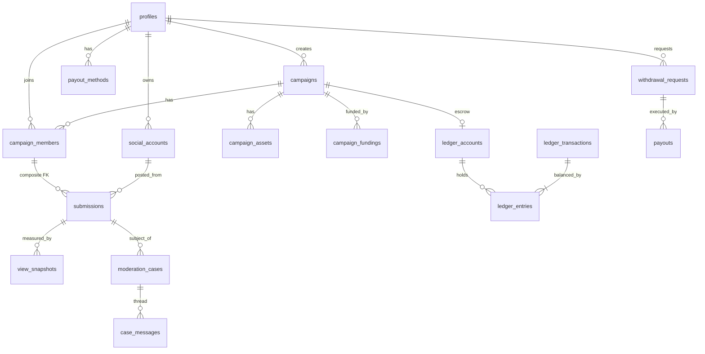
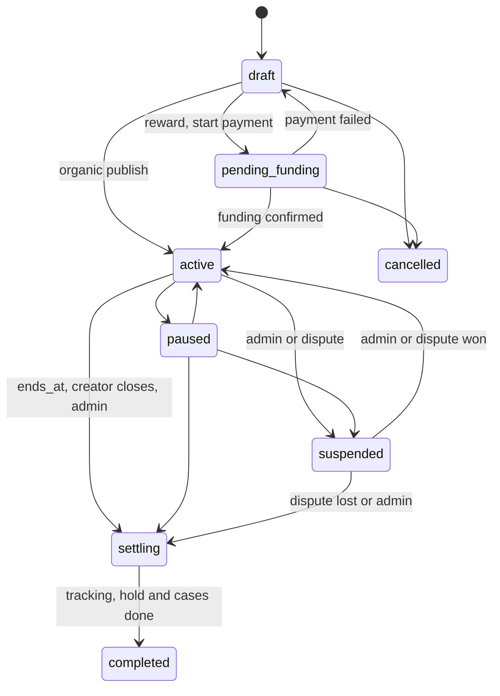
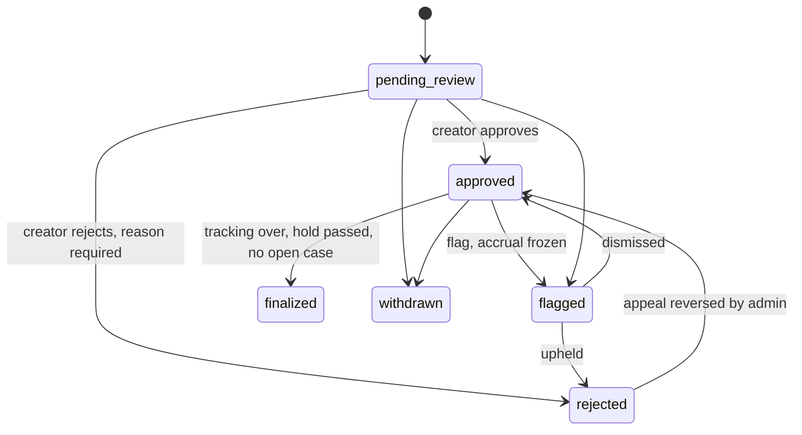

# ClipFoundry: Database Architecture (Phase 2.1, Revision 3)

**Status:** design for approval. No SQL, migrations, code or UI have been produced.
**Project baseline:** Phase 1 only. `supabase/` has a placeholder README and no migrations. Three Supabase helpers exist: a browser client and a session-bound server client (both anon/publishable key), and a server-only admin client (service-role key).

## Revision 3 change log

| # | Targeted correction | Where addressed |
|---|---|---|
| 1 | `view_snapshots` immutable vs internally mutable fields, evidence preservation, client write prevention. | §2.4 (`view_snapshots`), §5.4, §6.4 |
| 2 | Strict idempotency verification (key + actor + payload match; domain unique violations never treated as retries). | §5.1 (P6 & idempotency rules), §6.5, §7.6 |
| 3 | Race-condition prevention between creator/editor role activation and admin grants via row locking and DB constraints. | §2.1 (`profiles`, `admin_users`), §4 |
| 4 | Atomic ledger transaction posting, ordered account locking, balance updates, partial-write guards and full rollback. | §2.5, §7.5 |
| 5 | Secure `own_profile` view definition restricting private profile access strictly to `auth.uid()`. | §5.3 (`own_profile` view security) |

## Revision 2 change log

| # | Requested correction | Where addressed |
|---|---|---|
| 1 | One account can be both creator and editor. Admin stays separate and protected. | §4, `profiles`, RLS matrix (§5.3) |
| 2 | A post can never be submitted twice, even after withdrawal or rejection. | `submissions` constraints (§2.4), §9 |
| 3 | Tiered security model, RLS where safe, per-function authentication, authorisation, validation and audit. | §5.1 and §5.2 |
| 4 | Creators see editor handles only through a minimal snapshot on `submissions`. | `submissions`, `social_accounts`, §5.3 |
| 5 | Reward rules: exhaustion, top-ups, view decreases, manual vs API, idempotency. | §6 |
| 6 | Chargebacks, refunds, failed and reversed payouts, webhook duplicates, reconciliation, concurrency, system accounts. | §7, `ledger_accounts` |
| 7 | Completeness check of all 21 tables. | §2 (full column specs), §10 (findings) |

## 0. Conventions and approved decisions

**Approved by you:** currency INR; money as `bigint` paise; double-entry ledger; no separate wallets table (ledger accounts hold balances); creator fee of 10% **on top of** the reward pool; no editor commission; no minimum withdrawal; reward campaigns funded before activation.

| # | Convention |
|---|---|
| C1 | Money is `bigint` paise. CPM is paise per 1,000 views. No floats and no `numeric` for money. |
| C2 | Views are `bigint`. Timestamps are `timestamptz` (UTC). |
| C3 | Primary keys are `uuid default gen_random_uuid()`, except `view_snapshots`, `ledger_entries` and `audit_logs`, which use `bigint generated always as identity`. |
| C4 | Stable value sets are Postgres **enum** types. |
| C5 | Every `public` table has RLS **enabled and forced**. The default is deny. |
| C6 | Financial, submission, case and audit rows are never deleted (`ON DELETE RESTRICT`, no `DELETE` grant). Account deletion anonymises the profile. |
| C7 | Every table has `created_at timestamptz NOT NULL default now()`. Mutable tables also have `updated_at` (trigger-maintained). Both are omitted from the column tables below. |
| C8 | **Tiered write model (replaces the earlier "everything is service-role" rule):** Tier 1 is RLS-direct. Tier 2 is user-callable functions that derive the actor from `auth.uid()`. Tier 3 is service-role-only functions. See §5.1. |
| C9 | The `citext` extension is required (for `username`). |

## 1. Tables (21)

| Group | Table | Purpose |
|---|---|---|
| Identity | `profiles` | One row per user: identity plus creator/editor capability flags. |
| | `admin_users` | Admin grants, kept apart from `profiles`. |
| | `platform_settings` | Admin-managed settings. |
| Social | `social_accounts` | Editor's connected social identities. |
| | `social_account_tokens` | OAuth secret references. **Created only when an OAuth integration is chosen.** |
| Campaigns | `campaigns` | Organic and reward campaigns. |
| | `campaign_assets` | Source videos and assets. |
| | `campaign_members` | Editor ↔ campaign membership. |
| | `campaign_fundings` | Creator payments: pool, fee, refunds, disputes. |
| Submissions | `submissions` | Published post URLs submitted by editors. |
| | `view_snapshots` | Verified view counts (immutable evidence; internally controlled calculation and confirmation fields). |
| Money | `ledger_accounts` | Balance buckets. **These are the wallets.** |
| | `ledger_transactions` | Header of each balanced money movement. |
| | `ledger_entries` | Signed, immutable lines. |
| Payouts | `payout_methods` | Editor payout destinations (references and masked labels only). |
| | `withdrawal_requests` | Editor withdrawal requests. |
| | `payouts` | Execution attempts for a request. |
| Support | `notifications` | In-app notifications. |
| | `moderation_cases` | Unified flags, appeals and disputes. |
| | `case_messages` | Case thread and evidence. |
| Audit | `audit_logs` | Append-only audit trail. |

One non-table object is added: the view **`own_profile`**, which exposes the caller's private profile columns (§5.3).

## 2. Column specifications

`NN` = NOT NULL. `FK` actions are `ON DELETE RESTRICT` unless stated. Enum values are in §8 or noted inline.

### 2.1 Identity

**`profiles`**

| Column | Type | Null | Notes |
|---|---|---|---|
| `id` | uuid | NN | PK, FK → `auth.users(id)` |
| `username` | citext | NN | UQ. Check: 3–30 chars of lowercase letters, digits, underscore. Immutable in v1. |
| `display_name` | text | NN | Check: length 1–60 |
| `avatar_path` | text | | Storage path |
| `bio` | text | | Check: length ≤ 500 |
| `is_creator` | boolean | NN | default false |
| `is_editor` | boolean | NN | default false |
| `account_scope` | text | NN | default `'member'`. Check: `IN ('member', 'admin')` |
| `status` | profile_status | NN | default `active`. Values: `active`, `suspended`, `deleted` |

- Constraints:
  - `CHECK (account_scope = 'member' OR (NOT is_creator AND NOT is_editor))`: storage-engine guarantee that an admin-scoped account can never hold creator or editor flags.
  - `UQ (id, account_scope)`: supports the composite foreign key from `admin_users`.
- Rules enforced by trigger and column grants:
  - Flags are **monotonic** for clients (`false → true` only). Only service-role may clear one.
  - `account_scope` and `status` are excluded from client column grants (`anon` and `authenticated` cannot write them).
- Row creation: a trigger on `auth.users` inserts the profile with `account_scope = 'member'`. Signup metadata may request `is_creator` and/or `is_editor`. It can never set `account_scope = 'admin'` or grant admin.
- `country` was removed (not needed yet; revisit with KYC, D1).

**`admin_users`**

| Column | Type | Null | Notes |
|---|---|---|---|
| `user_id` | uuid | NN | PK |
| `account_scope` | text | NN | default `'admin'`. Check: `= 'admin'` |
| `granted_by` | uuid | | FK → `profiles`. Null only for the bootstrap admin. Check: `granted_by <> user_id`. |
| `granted_at` | timestamptz | NN | default now() |
| `revoked_at` | timestamptz | | Null = active |

- Composite FK: `(user_id, account_scope) → profiles(id, account_scope) ON DELETE RESTRICT ON UPDATE RESTRICT`. Prevents inserting an `admin_users` row unless `profiles.account_scope = 'admin'` (which in turn forces `is_creator = false AND is_editor = false` via `profiles` CHECK), and prevents reverting `account_scope` to `'member'` while an `admin_users` record exists.
- Trigger: locks `profiles` (`SELECT ... FOR UPDATE`) for `NEW.user_id` before verifying `account_scope = 'admin'`, `is_creator = false`, `is_editor = false`, and `status = 'active'` (§4).
- No client privileges or policies exist on this table.

**`platform_settings`**

| Column | Type | Null | Notes |
|---|---|---|---|
| `key` | text | NN | PK. Keys prefixed `public.` are readable by authenticated users. |
| `value` | jsonb | NN | |
| `description` | text | | |
| `updated_by` | uuid | | FK → `profiles` |

- Seeded with `public.default_platform_fee_bps = 1000` (approved).
- Other keys have no assumed values. Functions that need them **fail closed** if they are missing: `public.min_funding_paise`, `public.max_funding_paise`, `reward_hold_days`, `view_drop_flag_pct`, `appeal_window_days`, `tracking_grace_days`.

### 2.2 Social accounts

**`social_accounts`**

| Column | Type | Null | Notes |
|---|---|---|---|
| `id` | uuid | NN | PK |
| `editor_id` | uuid | NN | FK → `profiles` |
| `platform` | social_platform | NN | `youtube`, `instagram`, `tiktok` (extendable, D4) |
| `platform_user_id` | text | NN | The platform's stable account ID |
| `handle` | text | NN | |
| `profile_url` | text | NN | Check: starts with `https://` |
| `verification_status` | verification_status | NN | default `unverified`. Values: `unverified`, `pending`, `verified`, `revoked` |
| `verification_method` | text | | Check in `oauth`, `bio_code`, `manual` (D4) |
| `verified_at` | timestamptz | | |

- Check: `verification_status <> 'verified'` requires `verified_at` and `verification_method`.
- **UQ(`platform`, `platform_user_id`) WHERE `verification_status = 'verified'`**: only verified claims are exclusive. A squatter cannot block the real owner by claiming an unverified account.
- UQ(`editor_id`, `platform`, `platform_user_id`).
- Index on `editor_id`.

**`social_account_tokens`** (deferred until OAuth is chosen)

| Column | Type | Null | Notes |
|---|---|---|---|
| `social_account_id` | uuid | NN | PK, FK → `social_accounts` **ON DELETE CASCADE** |
| `access_secret_id` | uuid | NN | Supabase Vault secret ID, not ciphertext |
| `refresh_secret_id` | uuid | | Vault secret ID |
| `expires_at` | timestamptz | | |
| `scopes` | text[] | NN | default `{}` |
| `revoked_at` | timestamptz | | |

RLS is enabled with **no policies**, and all client privileges are revoked. Only service-role can read it, not even admins.

### 2.3 Campaigns

**`campaigns`**

| Column | Type | Null | Notes |
|---|---|---|---|
| `id` | uuid | NN | PK |
| `creator_id` | uuid | NN | FK → `profiles` |
| `title` | text | NN | Check: length 3–120 |
| `description` | text | NN | default `''`, length ≤ 5000 |
| `campaign_type` | campaign_type | NN | `organic`, `reward` |
| `status` | campaign_status | NN | default `draft` |
| `suspended_from` | campaign_status | | Where to resume from when `suspended` |
| `currency` | char(3) | NN | default `INR`, check `= 'INR'` |
| `cpm_paise` | bigint | | Check: `> 0` when set |
| `reward_pool_paise` | bigint | NN | default 0, check `>= 0`. Server-maintained total of succeeded pools net of refunds. |
| `platform_fee_bps` | int | | Check 0–10000. Informational: the **rate used at first funding**. The authoritative per-funding rate is on `campaign_fundings`. |
| `per_submission_cap_paise` | bigint | | Optional safeguard (D8). Check: `> 0` when set. |
| `starts_at` | timestamptz | NN | |
| `ends_at` | timestamptz | NN | Check: `ends_at > starts_at` |
| `requirements` | text | NN | default `''` |
| `allowed_platforms` | social_platform[] | NN | Check: cardinality ≥ 1 |
| `activated_at`, `closed_at` | timestamptz | | |

- Check on type: organic ⇒ `cpm_paise IS NULL AND reward_pool_paise = 0`; reward ⇒ `cpm_paise IS NOT NULL`.
- Triggers:
  - `campaign_type`, `cpm_paise`, `starts_at` and `per_submission_cap_paise` are **frozen after activation**. `ends_at` can only be extended.
  - A reward campaign's `draft → pending_funding → active` needs a succeeded funding.
  - `creator_id` must belong to a profile with `is_creator = true` at insert time.
  - A reward campaign gets its escrow ledger account at creation.
- Indexes: `(creator_id)`, `(status, ends_at)`, partial index on `status = 'active'`.
- **Remaining budget is not a column.** It is the escrow account balance.

**`campaign_assets`**

| Column | Type | Null | Notes |
|---|---|---|---|
| `id` | uuid | NN | PK |
| `campaign_id` | uuid | NN | FK → `campaigns` |
| `kind` | asset_kind | NN | `source_video`, `asset` |
| `title` | text | NN | length 1–120 |
| `file_name` | text | | |
| `storage_path` | text | | UQ when set |
| `external_url` | text | | Check: `https://` |
| `mime_type` | text | | |
| `size_bytes` | bigint | | `>= 0` |
| `duration_seconds` | int | | `>= 0` |
| `created_by` | uuid | NN | FK → `profiles` |

Check: exactly one of `storage_path` and `external_url` is non-null. Index on `campaign_id`.

**`campaign_members`**

| Column | Type | Null | Notes |
|---|---|---|---|
| `campaign_id` | uuid | NN | FK → `campaigns` |
| `editor_id` | uuid | NN | FK → `profiles` |
| `status` | member_status | NN | default `active`. `active`, `left`, `removed` |
| `joined_at` | timestamptz | NN | default now() |
| `left_at` | timestamptz | | |
| `removed_by` | uuid | | FK → `profiles` |
| `removed_reason` | text | | |

- PK(`campaign_id`, `editor_id`). Index on `editor_id`.
- Check: `status = 'removed'` requires `removed_by` and a reason of ≥ 5 characters.
- Trigger: the editor cannot be the campaign creator.
- A `left` editor may rejoin. A `removed` editor cannot.

**`campaign_fundings`**

| Column | Type | Null | Notes |
|---|---|---|---|
| `id` | uuid | NN | PK |
| `campaign_id` | uuid | NN | FK → `campaigns` |
| `creator_id` | uuid | NN | FK → `profiles`. The function enforces `= campaigns.creator_id`. |
| `reward_pool_paise` | bigint | NN | `> 0` |
| `platform_fee_bps` | int | NN | 0–10000. Rate snapshot. |
| `platform_fee_paise` | bigint | NN | `>= 0` |
| `total_charge_paise` | bigint | NN | Check: `= reward_pool_paise + platform_fee_paise` |
| `status` | funding_status | NN | default `pending` |
| `provider` | text | | |
| `provider_ref` | text | | Check: `(provider IS NULL) = (provider_ref IS NULL)` |
| `idempotency_key` | text | NN | UQ |
| `refunded_pool_paise` | bigint | NN | default 0 |
| `refunded_fee_paise` | bigint | NN | default 0 |
| `disputed_at` | timestamptz | | |
| `confirmed_at` | timestamptz | | |
| `ledger_transaction_id` | uuid | | FK → `ledger_transactions` (the funding entry) |

- Checks: `refunded_pool_paise <= reward_pool_paise`, `refunded_fee_paise <= platform_fee_paise`, and `confirmed_at` is set for any status other than `pending` and `failed`.
- UQ(`provider`, `provider_ref`) where `provider_ref` is not null. Index on `campaign_id`.
- Fee: `(pool × bps + 5000) div 10000` (half-up, integer), computed only server-side.

### 2.4 Submissions and views

**`submissions`**

| Column | Type | Null | Notes |
|---|---|---|---|
| `id` | uuid | NN | PK |
| `campaign_id` | uuid | NN | |
| `editor_id` | uuid | NN | **Composite FK (`campaign_id`, `editor_id`) → `campaign_members`** |
| `social_account_id` | uuid | NN | FK → `social_accounts` |
| `platform` | social_platform | NN | |
| `author_handle` | text | NN | **Snapshot** of the account handle at submission time |
| `author_profile_url` | text | NN | **Snapshot** (`https://`) |
| `post_url` | text | NN | As submitted (`https://`) |
| `normalized_url` | text | NN | Canonical form, derived server-side |
| `external_post_id` | text | NN | Platform's post ID, derived server-side |
| `posted_at` | timestamptz | NN | From the platform or manual verification, never the client |
| `status` | submission_status | NN | default `pending_review` |
| `status_before_flag` | submission_status | | |
| `rejection_code` | text | | |
| `rejection_reason` | text | | |
| `reviewed_by` | uuid | | FK → `profiles` |
| `reviewed_at`, `approved_at` | timestamptz | | |
| `baseline_views` | bigint | NN | default 0 (D6) |
| `latest_view_count` | bigint | NN | default 0. From the latest applied snapshot. |
| `eligible_views` | bigint | NN | default 0 |
| `reward_entitled_paise` | bigint | NN | default 0. Formula result **before** the budget cap. |
| `reward_accrued_paise` | bigint | NN | default 0. Reserved from escrow. |
| `reward_finalized_paise` | bigint | NN | default 0. Withdrawable. |
| `finalized_at` | timestamptz | | |

- **Duplicate prevention (corrected): `UQ(platform, external_post_id)` and `UQ(normalized_url)`, both unconditional.** No status filter, so withdrawn and rejected submissions keep the post locked.
- Rows are never deleted. They remain for appeals and audit.
- Checks:
  - `status <> 'rejected'` requires `length(trim(rejection_reason)) >= 10`.
  - `0 <= reward_finalized_paise <= reward_accrued_paise <= reward_entitled_paise`.
- Triggers:
  - The campaign must be organic ⇒ all reward columns stay 0.
  - `editor_id` must differ from the campaign's `creator_id`.
- Indexes: `(campaign_id, status)`, `(editor_id, status)`, partial index on `status = 'pending_review'`.

**`view_snapshots`** (no deletes; original evidence immutable)

| Column | Type | Null | Mutability & Notes |
|---|---|---|---|
| `id` | bigint | NN | **Immutable.** PK, identity |
| `submission_id` | uuid | NN | **Immutable.** FK → `submissions` |
| `captured_at` | timestamptz | NN | **Immutable.** Check: `<= created_at` |
| `view_count` | bigint | NN | **Immutable.** `>= 0` |
| `source` | snapshot_source | NN | **Immutable.** `platform_api`, `admin_manual` |
| `source_ref` | text | | **Immutable.** API request or event ID |
| `evidence_path` | text | | **Immutable.** Write-once Storage path |
| `raw` | jsonb | | **Immutable.** Original API payload |
| `created_by` | uuid | | **Immutable.** FK → `profiles`. Null for the system worker. |
| `confirmed_by` | uuid | | **Internally mutable (once).** FK → `profiles` |
| `confirmed_at` | timestamptz | | **Internally mutable (once).** |
| `applied` | boolean | NN | **Internally mutable (once).** default false. True if this snapshot drove accrual. |
| `eligible_views` | bigint | NN | **Internally mutable (until applied).** |
| `cpm_paise_applied` | bigint | | **Internally mutable (until applied).** |
| `reward_entitled_paise` | bigint | NN | **Internally mutable (until applied).** default 0. Cumulative as of this snapshot. |
| `reward_delta_paise` | bigint | NN | **Internally mutable (until applied).** default 0. **May be negative** (decrease). |
| `capped_by_budget` | boolean | NN | **Internally mutable (until applied).** default false |
| `ledger_transaction_id` | uuid | | **Internally mutable (until applied).** FK → `ledger_transactions` |

- Client write prevention and deletion blocking:
  - `INSERT`, `UPDATE`, `DELETE` and `TRUNCATE` privileges are revoked from `anon` and `authenticated`, and **no client write RLS policies exist**. Clients can never create, alter or remove snapshots.
  - `DELETE` and `TRUNCATE` are blocked for all roles (including `service_role`) by trigger and revoked grants.
- Field-level mutability rules (enforced by a `BEFORE UPDATE` trigger even on `service_role`, plus `updated_at` tracking):
  - **Strictly immutable columns** (`id`, `submission_id`, `captured_at`, `view_count`, `source`, `source_ref`, `evidence_path`, `raw`, `created_by`, `created_at`): any attempt to modify these values raises an exception, preserving original observation and evidence permanently. Storage objects under `snapshots/{submission_id}/…` are also write-once (no `UPDATE` or `DELETE`, §5.4).
  - **Confirmation columns** (`confirmed_by`, `confirmed_at`): updatable only by Tier 3 `admin_confirm_manual_snapshot` when `source = 'admin_manual'`, transitioning `NULL → non-null` once (`confirmed_by <> created_by` and both set together), then frozen permanently.
  - **Accrual outcome columns** (`applied`, `eligible_views`, `cpm_paise_applied`, `reward_entitled_paise`, `reward_delta_paise`, `capped_by_budget`, `ledger_transaction_id`): populated on `INSERT` or updated once from `applied = false → true` inside the same atomic `record_view_snapshot` transaction when linking `ledger_transaction_id`, then frozen permanently once `applied = true`. Later campaign top-ups (`reaccrue_campaign`) post separate ledger transactions against `submissions` and never overwrite historical snapshot rows.
- Checks:
  - `source = 'admin_manual'` requires `evidence_path` and `created_by`.
  - `(confirmed_by IS NULL) = (confirmed_at IS NULL)` and `confirmed_by <> created_by`.
- Constraints:
  - UQ(`submission_id`, `captured_at`).
  - UQ(`submission_id`, `source`, `source_ref`) where `source_ref` is not null.
- Index on `(submission_id, captured_at desc)`.

### 2.5 Ledger

**`ledger_accounts`**

| Column | Type | Null | Notes |
|---|---|---|---|
| `id` | uuid | NN | PK |
| `account_type` | ledger_account_type | NN | `system_external`, `platform_revenue`, `campaign_escrow`, `editor_pending`, `editor_available`, `editor_withdrawal_hold` |
| `owner_user_id` | uuid | | FK → `profiles` |
| `campaign_id` | uuid | | FK → `campaigns` |
| `currency` | char(3) | NN | default `INR`, check `= 'INR'` |
| `balance_paise` | bigint | NN | default 0. Trigger-maintained cache. |
| `allow_negative` | boolean | NN | default false |

- Shape check by type:
  - `system_*` and `platform_revenue`: both owner columns null.
  - `campaign_escrow`: `campaign_id` set, `owner_user_id` null.
  - `editor_*`: `owner_user_id` set, `campaign_id` null.
- Balance check: `allow_negative OR balance_paise >= 0`.
- **Uniqueness (corrected):** three partial unique indexes, because a plain unique key over a nullable column permits duplicates:
  - `UQ(account_type) WHERE account_type IN ('system_external','platform_revenue')`;
  - `UQ(owner_user_id, account_type) WHERE account_type LIKE 'editor_%'`;
  - `UQ(campaign_id) WHERE account_type = 'campaign_escrow'`.
- `allow_negative` is true only for `system_external`, `platform_revenue` and `editor_available`. A trigger lets `editor_available` go negative **only** inside `reward_clawback` or `payout_reversal` transactions (§7).
- System accounts are created by the first migration as system configuration, not sample data. Editor accounts are created with `ON CONFLICT DO NOTHING` when the editor flag is enabled.

**`ledger_transactions`**

| Column | Type | Null | Notes |
|---|---|---|---|
| `id` | uuid | NN | PK |
| `kind` | ledger_kind | NN | `campaign_funding`, `reward_accrual`, `reward_reversal`, `reward_finalization`, `reward_clawback`, `withdrawal_hold`, `withdrawal_release`, `payout_settled`, `payout_reversal`, `funding_refund`, `chargeback`, `chargeback_reversal`, `adjustment` |
| `idempotency_key` | text | NN | UQ |
| `external_ref` | text | | Provider event or refund ID |
| `campaign_id`, `submission_id`, `funding_id`, `withdrawal_id`, `payout_id` | uuid | | Nullable FKs, all RESTRICT |
| `reverses_transaction_id` | uuid | | FK → self. UQ when set: a transaction is reversed at most once. |
| `memo` | text | | Never contains secrets |
| `created_by` | uuid | | FK → `profiles`. Null = system. |

UQ(`kind`, `external_ref`) where `external_ref` is not null.

**`ledger_entries`** (immutable)

| Column | Type | Null | Notes |
|---|---|---|---|
| `id` | bigint | NN | PK, identity |
| `transaction_id` | uuid | NN | FK → `ledger_transactions` |
| `account_id` | uuid | NN | FK → `ledger_accounts` |
| `amount_paise` | bigint | NN | Signed. Check `<> 0` |

Indexes: `(account_id, id)` and `(transaction_id)`.

- Deferred constraint triggers (`DEFERRABLE INITIALLY DEFERRED`, forced `IMMEDIATE` inside `post_ledger_transaction`, §7.5) on **both** `ledger_transactions` and `ledger_entries` require `COUNT(*) >= 2` and `SUM(amount_paise) = 0` per transaction, preventing entry-less headers, single-legged writes and unbalanced transactions.
- Triggers and revoked grants block `UPDATE`, `DELETE` and `TRUNCATE` on both `ledger_transactions` and `ledger_entries`.
- A synchronous `AFTER INSERT` trigger applies each entry to `ledger_accounts.balance_paise` while the target accounts are already locked `FOR UPDATE` (§7.5).

### 2.6 Withdrawals and payouts

**`payout_methods`**

| Column | Type | Null | Notes |
|---|---|---|---|
| `id` | uuid | NN | PK |
| `editor_id` | uuid | NN | FK → `profiles` |
| `method_type` | text | NN | Check in `upi`, `bank_account` |
| `display_label` | text | NN | Masked, e.g. "UPI ••••@okbank" |
| `provider` | text | | |
| `provider_ref` | text | | |
| `vault_secret_id` | uuid | | |
| `verified_at` | timestamptz | | |
| `is_default` | boolean | NN | default false |
| `deleted_at` | timestamptz | | Soft delete |

Checks: `provider_ref IS NOT NULL OR vault_secret_id IS NOT NULL`. UQ(`editor_id`) where `is_default AND deleted_at IS NULL`. No raw bank or UPI data is stored in plain columns.

**`withdrawal_requests`**

| Column | Type | Null | Notes |
|---|---|---|---|
| `id` | uuid | NN | PK |
| `editor_id` | uuid | NN | FK → `profiles` |
| `amount_paise` | bigint | NN | Check `> 0`. **No minimum.** |
| `payout_method_id` | uuid | NN | FK → `payout_methods` |
| `status` | withdrawal_status | NN | default `requested` |
| `idempotency_key` | text | NN | UQ(`editor_id`, `idempotency_key`) |
| `hold_transaction_id` | uuid | NN | FK, `DEFERRABLE INITIALLY DEFERRED`, filled in the same transaction |
| `reviewed_by` | uuid | | FK → `profiles` |
| `reviewed_at`, `completed_at` | timestamptz | | |
| `rejection_reason` | text | | Required when `rejected` |
| `requested_at` | timestamptz | NN | default now() |

Indexes: `(editor_id, requested_at desc)` and a partial index on open statuses.

**`payouts`**

| Column | Type | Null | Notes |
|---|---|---|---|
| `id` | uuid | NN | PK |
| `withdrawal_id` | uuid | NN | FK → `withdrawal_requests` |
| `provider` | text | NN | |
| `provider_payout_ref` | text | | |
| `amount_paise` | bigint | NN | `> 0`. Function enforces `= withdrawal amount`. |
| `status` | payout_status | NN | default `initiated`. `initiated`, `succeeded`, `failed`, `reversed` |
| `failure_reason` | text | | |
| `initiated_by` | uuid | | FK → `profiles`. Null = system. |
| `paid_at` | timestamptz | | |
| `settle_transaction_id`, `reversal_transaction_id` | uuid | | FKs → `ledger_transactions` |

- **Partial `UQ(withdrawal_id) WHERE status IN ('initiated','succeeded')`**: only one live attempt per request, so a double payout is impossible.
- UQ(`provider`, `provider_payout_ref`) where not null.

### 2.7 Support and audit

**`notifications`**

| Column | Type | Null | Notes |
|---|---|---|---|
| `id` | uuid | NN | PK |
| `user_id` | uuid | NN | FK → `profiles` |
| `type` | text | NN | |
| `title` | text | NN | |
| `body` | text | | |
| `data` | jsonb | NN | default `{}`. IDs only. |
| `read_at` | timestamptz | | |

Index: `(user_id, created_at desc) WHERE read_at IS NULL`.

**`moderation_cases`**

| Column | Type | Null | Notes |
|---|---|---|---|
| `id` | uuid | NN | PK |
| `case_type` | case_type | NN | `flag`, `appeal`, `dispute` |
| `submission_id`, `campaign_id`, `withdrawal_id` | uuid | | Nullable FKs |
| `opened_by` | uuid | | FK → `profiles`. Null = system flag. |
| `status` | case_status | NN | default `open` |
| `reason_code` | text | NN | |
| `description` | text | NN | |
| `resolution_notes` | text | | |
| `resolved_by` | uuid | | FK → `profiles` |
| `resolved_at` | timestamptz | | |

- Checks:
  - At least one subject is non-null.
  - An appeal requires `submission_id`.
  - A resolved status requires `resolved_at`.
- **UQ(`submission_id`) WHERE `case_type = 'appeal'`**: one appeal per submission (assumed, D12).
- Index on `(status, created_at)`.

**`case_messages`**

| Column | Type | Null | Notes |
|---|---|---|---|
| `id` | uuid | NN | PK |
| `case_id` | uuid | NN | FK → `moderation_cases` |
| `author_id` | uuid | NN | FK → `profiles` |
| `body` | text | NN | Length 1–5000 |
| `attachment_path` | text | | |
| `is_internal` | boolean | NN | default false. Admin-only note. |

Index: `(case_id, created_at)`.

**`audit_logs`** (append-only)

| Column | Type | Null | Notes |
|---|---|---|---|
| `id` | bigint | NN | PK, identity |
| `actor_id` | uuid | | **No FK** (stays independent of profile changes) |
| `actor_type` | text | NN | `user`, `admin`, `system` |
| `action` | text | NN | e.g. `withdrawal.request` |
| `entity_type` | text | NN | |
| `entity_id` | uuid | | |
| `before`, `after` | jsonb | | Never contain secrets |
| `reason` | text | | |
| `ip` | inet | | |
| `user_agent` | text | | |
| `request_id` | text | | |

Updates, deletes and truncates are blocked. Indexes: `(entity_type, entity_id, id desc)` and `(actor_id, id desc)`.

## 3. Relationships

## 4. Roles and admin model (correction 1)

**Representation:** two boolean flags on `profiles` (`is_creator`, `is_editor`). A user can hold either or both. This avoids an extra table, since there are only two fixed capacities.

**Capacity-based RLS:** policies are keyed to **ownership of the row**, not to a global role. A user acts as a creator on campaigns they own and as an editor on memberships and submissions that carry their `editor_id`. A user with both flags simply gets the union. Flags are checked only when creating things (inserting a campaign, joining a campaign).

**Self-dealing guards** (a dual-role user must not farm their own campaign):
- the join policy excludes campaigns the user created;
- `campaign_members` and `submissions` carry triggers that reject `editor_id = campaigns.creator_id`;
- `create_submission` re-checks the same rule.

**Money separation:** a creator pays per campaign into that campaign's escrow account. An editor's earnings live in that user's `editor_*` accounts. The two never mix.

**Enabling a role:** Tier 1. A user may flip a flag from false to true on their own profile if the profile is active and not an admin. Flags never go back to false for clients, because that would orphan campaigns and balances.

**Admin privileges (separate and protected):**
- They live only in `admin_users`, with no client privileges or policies. Roles are never derived from `user_metadata`, which is user-editable, or from any client-supplied claim.
- `is_admin()` requires an active `admin_users` row (`revoked_at IS NULL`) **and** `profiles.account_scope = 'admin'` **and** an MFA (`aal2`) session. The Next.js server checks `aal2` as well.
- Admin accounts must have both marketplace flags false (`is_creator = false`, `is_editor = false`). This gives separation of duty: an admin cannot earn, fund or appear as a party.
- Admin grants and revokes happen only through a manual, audited service-role operation (`admin_grant_admin`). v1 has no admin-granting UI. Any change to `admin_users` is logged by trigger.
- Admin functions additionally refuse to act on cases or rows where the admin is a party.

**Race-condition prevention between role activation and admin grants:**
Under PostgreSQL `READ COMMITTED`, checking `admin_users` inside a `profiles` trigger and checking `profiles` inside an `admin_users` trigger without shared locking would allow concurrent transactions (write skew) to commit both a marketplace role flag and an admin grant for the same user. Mutual exclusion is guaranteed by **transactional row-lock serialisation** plus **relational constraints**:
1. **Single-row lock serialisation (`profiles`):** Enabling `is_creator` or `is_editor` updates `profiles`, acquiring an exclusive row lock on `profiles(id)`. Conversely, `admin_grant_admin` (and the `BEFORE INSERT OR UPDATE` trigger on `admin_users`) executes `SELECT id, is_creator, is_editor, account_scope, status FROM public.profiles WHERE id = p_user_id FOR UPDATE` **first**, before updating `profiles.account_scope = 'admin'` and inserting into `admin_users`. Concurrent role activation and admin grant operations on the same user block on `profiles(id)` and execute strictly one after the other against committed state.
2. **Database constraint backstop:** `profiles` enforces `CHECK (account_scope = 'member' OR (NOT is_creator AND NOT is_editor))` and `UQ (id, account_scope)`, while `admin_users` enforces `CHECK (account_scope = 'admin')` and composite `FK (user_id, account_scope) → profiles(id, account_scope) ON DELETE RESTRICT ON UPDATE RESTRICT`. Neither state can exist simultaneously at the storage engine level, regardless of isolation level or caller.

## 5. Security model

### 5.1 Tiered write model (correction 3)

| Tier | What | Caller identity | Service-role? |
|---|---|---|---|
| **1: RLS-direct** | Low-risk, user-owned writes, protected by RLS `USING`/`WITH CHECK` and column-level grants. | User-bound Supabase client; the actor is `auth.uid()` in the JWT. | No |
| **2: User-callable functions** | Intent-based actions on the user's own data that touch ledger or state machines. `SECURITY DEFINER`, `EXECUTE` granted to `authenticated`. Take only **user-intent inputs** and derive the actor from `auth.uid()`. | Next.js server calls `.rpc()` through the **user-bound** client. | No |
| **3: Service-role functions** | Anything that needs server-verified facts (provider events, platform data, cron) or admin power. `EXECUTE` revoked from `public`, `anon`, `authenticated`. | Server-only code using the admin client after authenticating the caller. | Yes |

**Tier 1 (RLS-direct) operations:**
- Update own profile (display name, bio, avatar), and enable a role flag.
- Create and edit own **draft** campaigns. `status`, `reward_pool_paise`, `platform_fee_bps` and `activated_at` are not in the column grants.
- Add and remove campaign assets on own campaigns.
- Insert an **unverified** social account claim, and delete own accounts that have no submissions.
- Join, leave and rejoin a campaign. The join policy requires an active campaign, an editor flag, a non-owner and an open window.
- Set `is_default` and `deleted_at` on own payout methods.
- Mark own notifications read.
- Post a non-internal message on a case the user can see.

**Why these are safe in Tier 1:** the inputs are the user's own proposals or preferences, never money, views or trust decisions. The data is validated by CHECK constraints and frozen by trigger at activation. Joining is free, so no money moves. Sensitive Tier 1 changes (role flags, social accounts, payout methods, membership) are written to `audit_logs` by **database triggers**, which see `auth.uid()`.

**Standard call pipeline, applied to every Tier 2 and Tier 3 function:**

| Step | Rule |
|---|---|
| **P1: Authenticate** | The server action or route handler runs `supabase.auth.getUser()` on the cookie-bound server client. It **never** relies on `getSession()` or on decoding the cookie. The actor ID is `user.id` from that call. |
| **P2: Never trust browser IDs** | No request body, query or form field may carry a user or actor ID, and any such field is ignored. IDs of campaigns, submissions or withdrawals in the input are **untrusted references**. The database authorises each one by ownership. |
| **P3: Authorise (in the database)** | The function re-checks, under row locks: ownership, the creator/editor flag, `profiles.status = 'active'`, legal state transition, and the self-dealing rule. Tier 2 reads the actor from `auth.uid()`. Tier 3 receives `p_actor_id` **only** from server code that has just run P1. |
| **P4: Validate inputs** | The server validates shape and range with a schema (types, lengths, positive integers). The database re-validates, because it is authoritative. Money inputs are integer paise, bounded by settings. |
| **P5: Audit** | The function writes `audit_logs` in the **same transaction** (`actor_id`, `actor_type`, action, entity, `before`/`after`, reason, `request_id`). Ledger moves also record `ledger_transactions.created_by`. |
| **P6: Failure & Idempotency** | The function fails closed, rolling back the entire transaction with no partial effect. **A generic `unique_violation` is never blindly treated as a successful retry**—see the idempotency verification rules below. |

**Idempotency verification rules (applied to all retryable mutations):**
- **Domain uniqueness vs idempotency keys:** Violations of business/domain uniqueness constraints (`submissions` duplicate `normalized_url` or `(platform, external_post_id)`, `profiles.username`, `social_accounts` verified identity, `moderation_cases` one-appeal-per-submission, `payouts` one-live-attempt) always fail closed with an explicit domain conflict error and are never treated as retries.
- **Explicit key lookup and parameter verification:** Idempotent replay applies **only** to dedicated deduplication keys (`idempotency_key` on `withdrawal_requests`, `campaign_fundings` and `ledger_transactions`; `(provider, provider_ref)` / `(kind, external_ref)` on webhooks; `(submission_id, source, source_ref)` on API snapshots). When an existing record is found for that key (either via pre-check under lock or after catching a conflict on that specific named constraint):
  1. **Verify actor ownership** (for user-scoped operations, e.g., `editor_id = auth.uid()` on `withdrawal_requests`, `creator_id = p_actor` on `campaign_fundings`).
  2. **Verify original operation parameters match** (e.g., `(amount_paise, payout_method_id)` for withdrawals; `(campaign_id, reward_pool_paise)` for funding intents; `(kind, target entity IDs, entry account/amount vector)` for ledger transactions; `(amount, currency)` for webhooks; `(view_count, captured_at)` for API snapshots).
  3. **Return or reject:** Only if the key, actor and parameters all match does the function return the stored original result without re-running side effects. If the key exists with different parameters or a different actor, the function raises an `idempotency_key_mismatch` error and aborts.

**Admin variant (P1 plus):** the server also checks the MFA assurance level is `aal2`, and the function verifies `admin_users`. **Webhook variant:** the caller is the payment or payout provider. The handler verifies the provider signature over the **raw** body and checks timestamp tolerance (replay window), then derives all facts from our own stored records. **Job variant:** scheduled jobs authenticate with a `CRON_SECRET` bearer token compared in constant time. The secret lives only in server environment variables.

The service-role client is built only in `server-only` modules. It is never used to serve a request on the user's behalf, apart from the Tier 3 functions listed below.

### 5.2 Privileged function catalogue

**Tier 2: user-callable (actor = `auth.uid()`)**

| Function | Authorises | Validates | Audit and effects |
|---|---|---|---|
| `request_withdrawal(amount, payout_method_id, idempotency_key)` | Caller has the editor flag and an active profile. The payout method is theirs, verified and not deleted. | Amount `> 0`. Locks `editor_available` and requires balance ≥ amount (no negative balance). Idempotency key unique per editor. | `withdrawal_hold` ledger move. `withdrawal.request`. |
| `cancel_withdrawal(withdrawal_id)` | Owner, status `requested` only. | | `withdrawal_release`. `withdrawal.cancel`. |
| `transition_campaign(campaign_id, action)` | Owner. Actions: `publish_organic`, `pause`, `resume`, `close`, `cancel`. The move must be legal per §8. | `publish_organic` needs an organic campaign with complete required fields and valid dates. `close` moves to `settling`. | `campaign.<action>`. Notifications. |
| `review_submission(submission_id, decision, rejection_code, reason)` | Caller owns the campaign. Submission is `pending_review`. Campaign not suspended. | `reject` needs a reason of ≥ 10 characters. | Sets `approved_at` or the rejection. `submission.review`. Notifies the editor. |
| `withdraw_submission(submission_id)` | The submitting editor. Status `pending_review` or `approved`. No open case. | | Reverses the unfinalised accrual (`reward_reversal`), keeps the finalised part. `submission.withdraw`. |
| `remove_campaign_member(campaign_id, editor_id, reason)` | Owner. | Reason ≥ 5 characters. | Existing approved submissions keep earning. `member.remove`. |
| `open_case(type, subject_id, reason_code, description)` | `flag`: caller owns the subject campaign. `appeal`: caller is the editor of a `rejected` submission with no prior appeal, inside `appeal_window_days`. `dispute`: caller is a party. | Lengths. One appeal per submission. | `case.open`. |

Tier 2 functions are safe even if the browser calls them directly with the anon key and its own session, because they derive the actor from the JWT and trust no ID the browser supplies.

**Tier 3: service-role only**

| Function | Authenticated by | Authorises | Validates | Audit and effects |
|---|---|---|---|---|
| `create_funding_intent(p_actor, campaign_id, pool_paise, idempotency_key)` | P1 | Actor owns the campaign, which is `draft`, `pending_funding`, `active` or `paused` (a top-up). Never `settling` or later. | Pool within `public.min/max_funding_paise`. **Fee computed from `public.default_platform_fee_bps`**, never from client input. | Creates a `pending` funding. Server builds the provider checkout from the stored total. `funding.create`. |
| `confirm_funding(provider, provider_ref, event_id, amount, currency)` | Provider signature plus timestamp | Funding exists (created by our server), status `pending`. | Amount equals `total_charge_paise`. Currency `INR`. | `campaign_funding` ledger move. Draft or `pending_funding` becomes `active`. Triggers `reaccrue_campaign` (§6). Replay is a no-op. |
| `record_refund(funding_id, pool_amt, fee_amt, provider_refund_ref)` | Admin (P1 + aal2) or provider webhook | Admin refunds need a reason. | `pool_amt` ≤ escrow balance and ≤ remaining pool. `fee_amt` ≤ remaining fee. | `funding_refund` move. `funding.refund`. |
| `record_chargeback(funding_id, event_id)` and `resolve_chargeback(...)` | Provider signature | Funding `succeeded` or `disputed`. | | §7 treatment. `funding.chargeback`. |
| `create_submission(p_actor, campaign_id, social_account_id, post_url, verified_post_facts)` | P1. The server obtains `verified_post_facts` (`external_post_id`, `author_platform_id`, `posted_at`) from the platform API or manual flow. | Actor is an active editor member and not the campaign creator. Campaign is `active` and its budget is not exhausted. The social account is the actor's and `verified`, and `author_platform_id` matches it. `posted_at` is on or after `joined_at` (D6). | Server canonicalises the URL and extracts the post ID. Inserts with the author snapshot. A duplicate post raises an `"already submitted"` domain conflict error (never treated as a retry). | `submission.create`. |
| `verify_social_account(...)` | OAuth callback (state/CSRF checked) or admin | Account belongs to the caller. | Platform returns the same `platform_user_id`. Tokens go to Vault. | `social.verify`. |
| `record_view_snapshot(submission_id, view_count, source, source_ref, captured_at, evidence_path?)` | Scheduled job (`CRON_SECRET`). Manual variant: admin (P1 + aal2). | Submission `approved`. Campaign not suspended. | `captured_at` not in the future. See §6.4 for manual rules. | Inserts the snapshot, runs accrual in the same transaction. `snapshot.record`. |
| `reaccrue_campaign(campaign_id)` | Internal (called by `confirm_funding`, reversals) | | Locking order in §7.5 | `reward_accrual` moves. |
| `finalize_rewards()` | Scheduled job | | Skips submissions with open cases or unconfirmed manual snapshots. | `reward_finalization` moves. |
| `settle_campaign(campaign_id)` | Scheduled job | Campaign `settling`, tracking and hold finished. | | Final finalisation. `funding_refund` of unspent escrow (D5). Sets `completed`. |
| `approve_withdrawal`, `initiate_payout`, `record_payout_result` | Admin (P1 + aal2) or provider webhook | Withdrawal status and amount match. | Only one live payout per request (unique index). | `payout_settled`, `withdrawal_release`, or `payout_reversal` (§7). |
| `resolve_case(case_id, outcome, notes)` | Admin | Admin is not a party. Notes required. | | May call `reward_reversal` or `reward_clawback` and set submission status. `case.resolve`. |
| `admin_set_user_status`, `admin_set_campaign_status`, `admin_adjustment`, `admin_confirm_manual_snapshot`, `admin_grant_admin` | Admin (P1 + aal2) | `confirm` needs `confirmed_by <> created_by`. `admin_grant_admin` locks `profiles` `FOR UPDATE`, sets `account_scope = 'admin'` (requiring both role flags false), and inserts `admin_users` atomically. `adjustment` needs a reason. | Reason required for all. | Full `before`/`after` audit. |
| `notify(user_id, type, data)` | Internal | | `data` carries IDs only. | |

### 5.3 RLS policy matrix

Helper functions (`SECURITY DEFINER`, `search_path = ''`, `EXECUTE` revoked from `anon`): `is_admin()`, `has_role(role)`, `owns_campaign(campaign_id)`, `is_active_member(campaign_id)`. Legend: **R** = select; **W-T1** = Tier 1 RLS write; **T2/T3** = write only through that tier's functions. A user with both flags gets the union of the "creator" and "editor" columns.

| Table | As creator (owns the campaign) | As editor (owns the row) | Admin | Notes |
|---|---|---|---|---|
| `profiles` | R public columns of all profiles (column grants: `id`, `username`, `display_name`, `avatar_path`, `bio`, `is_creator`, `is_editor`, `created_at`). W-T1 own `display_name`, `bio`, `avatar_path` and flag false→true. | same | R all (private columns via T3) | Private columns (`status`, `account_scope`, `updated_at`) are exposed to the owner solely via `own_profile`, and to admins via server-only Tier 3 queries. |
| `admin_users` | none | none | none directly | Checked only inside `is_admin()`. |
| `platform_settings` | R `public.*` keys | same | R all, W T3 | |
| `social_accounts` | **none** | R own. W-T1 insert unverified claim, delete own with no submissions. | R all | See submissions rows below. |
| `social_account_tokens` | none | none | none | Service-role only. |
| `campaigns` | R own, all statuses. W-T1 insert and edit own **draft**. Status moves T2/T3. | R where `status IN (active, paused, settling, completed)` | R all, W T3 | Browsing is authenticated only (D10). |
| `campaign_assets` | R own. W-T1 insert and delete on own campaign while `draft`, `active` or `paused`. | R if `is_active_member` and campaign `active`, `paused` or `settling` | R all | Storage policy mirrors this. |
| `campaign_members` | R members of own campaigns. Removal T2. | R own. W-T1 join (insert), leave and rejoin (update `status`). | R all | The join policy checks the campaign is `active`, the editor flag, a non-owner, and the budget not exhausted. |
| `campaign_fundings` | R own | none | R all | W T3. |
| `submissions` | R for own campaigns, **including `author_handle`, `author_profile_url`, `platform`**. Review T2. | R own. Create T3, withdraw T2. | R all | The minimal exposure is the snapshot columns. See below. |
| `view_snapshots` | R for own campaigns. Column grants exclude `raw`, `source_ref`, `evidence_path`, `created_by`. | R own submissions, same columns | R all | W T3 only. |
| `ledger_accounts` | R own campaign's escrow | R own `editor_*` accounts | R all | The platform and system accounts are admin-only. |
| `ledger_entries` | R entries on own campaign escrow only | R entries on own accounts | R all | Never other editors' entries. |
| `ledger_transactions` | R if a readable entry belongs to it | same | R all | W T3, immutable. |
| `payout_methods` | none | R own. W-T1 `is_default`, `deleted_at`. Insert T3. | R all | Masked data only. |
| `withdrawal_requests` | none | R own | R all | Create and cancel T2. |
| `payouts` | none | R own via withdrawal. Column grants exclude provider references. | R all | W T3. |
| `notifications` | R own, W-T1 `read_at` | same | R all | Insert T3. |
| `moderation_cases` | R cases they opened or on their campaign's subjects | R cases they opened or on their own submissions | R all | Open T2, resolve T3. |
| `case_messages` | R and W-T1 on visible cases (`is_internal = false`, `author_id = auth.uid()`) | same | R all, internal notes T3 | |
| `audit_logs` | none | none | R | W T3 only. |

**Social handle visibility (correction 4):** the `social_accounts` table is not readable by creators. Instead the server copies `handle` and `profile_url` onto the submission when it creates it. Creators read those two fields and `platform` through `submissions`. They never see `platform_user_id`, verification method, tokens or the editor's other accounts. The snapshot also keeps the audit trail accurate if the editor later renames or disconnects the account. The earlier matrix said both "creators see handles" and "creators have no access to `social_accounts`". Both are now consistent.

**`own_profile` view security:**
- **Purpose:** Exposes the authenticated caller's own full profile row—including private columns (`status`, `account_scope`, `updated_at`) withheld from table-level `SELECT` column grants on `public.profiles`—without widening column grants on `public.profiles` for other rows.
- **Strict `auth.uid()` row restriction:** Defined as `SELECT id, username, display_name, avatar_path, bio, is_creator, is_editor, account_scope, status, created_at, updated_at FROM public.profiles WHERE auth.uid() IS NOT NULL AND id = auth.uid()` with **`WITH (security_barrier = true)`**.
- **Execution and side-channel safety:** Because `authenticated` lacks `SELECT` privileges on the private columns of `public.profiles`, the view executes with owner read privileges (`security_invoker = false`) while `security_barrier = true` prevents user-supplied `WHERE` predicates or functions from being pushed down ahead of `id = auth.uid()`. Unauthenticated callers (`auth.uid() IS NULL`) or queries targeting any other user ID always receive zero rows—not even admins can read another user's row through `own_profile`.
- **Read-only privileges:** `REVOKE ALL ON public.own_profile FROM PUBLIC, anon;` and `GRANT SELECT ON public.own_profile TO authenticated;` only. No `INSERT`, `UPDATE` or `DELETE` privileges are granted on the view, preventing clients from mutating private columns through view auto-updatability.

### 5.4 Storage RLS

| Bucket | Access |
|---|---|
| `campaign-assets` (private) | Upload and delete by the campaign owner into `{own_campaign_id}/…`. Read by the owner, by active members while the campaign is `active`, `paused` or `settling`, and by admins. Downloads use short-lived signed URLs issued by the server. |
| `case-evidence` (private) | Read and upload by case participants and admins, path `{case_id}/…`. Admin manual-snapshot evidence uses unique, non-overwritable paths under `snapshots/{submission_id}/{evidence_uuid}_{file_name}` (admin/service-role upload with `upsert: false`, admin read only; see write-once evidence controls below). |
| `avatars` | Optional. Public read; write only inside own `{user_id}/` folder. |

**Write-once manual-snapshot evidence controls (`case-evidence`):**
Manual-snapshot evidence remains a strict **write-once** business and audit requirement, distinguished from what Storage RLS alone can technically enforce (since Supabase `service_role` bypasses `storage.objects` RLS):
1. **Storage RLS for client roles:** Storage RLS denies `UPDATE` and `DELETE` on `case-evidence` evidence objects for ordinary client roles (`anon` and `authenticated`, including admins using session-bound clients).
2. **Unique, non-overwritable object paths:** Every evidence upload uses a unique generated object key (`snapshots/{submission_id}/{evidence_uuid}_{file_name}`) with `upsert: false`, preventing path collisions and overwrites on upload.
3. **Application workflow prohibition:** Ordinary application and server workflows must never overwrite, move or delete evidence objects.
4. **Controlled `service_role` maintenance:** Because `service_role` bypasses Storage RLS, privileged `service_role` Storage maintenance is separately controlled outside normal application flows, must be explicitly authorised and recorded in `audit_logs` with a reason, and must never be used for routine evidence modification or deletion.

Anyone who can view a source video can copy it. Storage rules cannot prevent that (D11).

### 5.5 Protection of sensitive data
- **OAuth tokens:** Supabase Vault. `social_account_tokens` has no policies and revoked client grants. Tokens are never logged or sent to the browser.
- **Payout details:** a provider reference or Vault ID plus a masked label only (D2).
- **Money:** clients get row-scoped read only. Writes go through Tier 2 or Tier 3 functions, and ledger and audit rows are immutable.
- **Functions:** `EXECUTE` is revoked from `public`, `anon` and `authenticated` on every Tier 3 function. The service-role key stays in `server-only` code.
- **Audit and notification payloads** never contain secrets or tokens.

## 6. Ledger flows and reward calculation

### 6.1 Ledger flows

Each transaction sums to 0. `system_external` mirrors money at the payment provider or bank, so it goes negative while the platform holds funds for others.

| Event | Ledger transaction |
|---|---|
| Funding succeeds (pool P, fee F) | `system_external −(P+F)`, `campaign_escrow +P`, `platform_revenue +F` |
| Reward accrues (R) | `campaign_escrow −R`, `editor_pending +R`. The budget is **reserved**. |
| Accrual decreases (pre-finalisation) | The reverse of the decrease amount. |
| Reward finalises (R) | `editor_pending −R`, `editor_available +R` |
| Withdrawal requested (A) | `editor_available −A`, `editor_withdrawal_hold +A` |
| Payout settles | `editor_withdrawal_hold −A`, `system_external +A` |
| Failed payout or cancelled request | `editor_withdrawal_hold −A`, `editor_available +A` |

Chargebacks, refunds, clawbacks and reversed payouts are in §7.

### 6.2 Reward formula (server only)

For an approved submission, using the **latest applied snapshot**:
1. `eligible_views = max(0, view_count − baseline_views)`.
2. `entitled = floor(eligible_views × cpm_paise / 1000)`, then `min(entitled, per_submission_cap_paise)` if a cap exists. Rounding is always **down**, in integer arithmetic.
3. `new_accrued = clamp(entitled, lower = reward_finalized_paise, upper = reward_accrued_paise + escrow_balance)`.
4. `delta = new_accrued − reward_accrued_paise`. It can be negative, but the lower clamp means accrued never drops below what is already finalised.
5. If the upper bound limited the result, set `capped_by_budget = true`. The shortfall is `entitled − accrued`.
6. Post one ledger transaction for the delta, then update the submission and snapshot rows.

Example: ₹50 CPM is 5,000 paise. 12,345 views gives `floor(12345 × 5000 / 1000)` = 61,725 paise = ₹617.25.

### 6.3 Funds exhausted, top-ups, view decreases

**When funds are exhausted** (escrow balance 0):
- New accruals are capped at the remaining balance, and later views earn nothing.
- Approved submissions stay `approved`. Snapshots keep being recorded, so entitlement is still tracked.
- **New joins and new submissions are blocked** by the join policy and `create_submission`, so editors are not misled into joining a campaign with no money left.
- The campaign stays `active`. It is **not** auto-settled, because a top-up or reversal can refill the escrow. It moves to `settling` at `ends_at` or when the creator closes it.

**Top-ups and previously capped views:**
- Yes, they can be paid. `reward_entitled_paise` is stored separately from `reward_accrued_paise`, so a shortfall is visible and recoverable.
- After a top-up (or any reversal that frees escrow), `reaccrue_campaign` runs. It picks approved submissions with `entitled > accrued` in a fixed order (`approved_at`, then `id`) and posts accruals until the escrow is empty again. The same order every time keeps the outcome deterministic and fair.
- Top-ups are allowed only while the campaign is `active` or `paused`. Once `settling` begins, any remaining shortfall is **forfeited** and the creator can no longer top up. CPM never changes. A top-up adds budget only.
- Editors are shown that earnings depend on remaining budget. Nothing is guaranteed.

**When reported views decrease:**
- The snapshot is stored as received (raw history is preserved).
- **Before finalisation**, entitlement follows the latest applied snapshot. A decrease lowers `eligible_views` and reverses the difference out of `editor_pending` back to escrow (a `reward_reversal`). Platforms often purge fake or duplicate views, so this prevents paying for them.
- A drop larger than `view_drop_flag_pct` (setting, D6) also opens a system `flag` case and freezes further accrual until an admin resolves it.
- **After finalisation**, finalised money is never reduced by a view drop. It can only be recovered through an upheld moderation case and a `reward_clawback` (§7).

**Finalisation (rolling):** `finalize_rewards` finalises, per submission, `new_finalized = max(finalized, min(accrued, reward computed from the newest snapshot that is at least reward_hold_days old))`. Editors can therefore withdraw part of their earnings before the campaign ends, but only after the hold. The submission becomes `finalized` after the campaign's tracking window closes, its final snapshot is applied and the hold has passed. The alternative, one finalisation at campaign end, would delay all editors. D6 holds the choice.

### 6.4 Manual vs official API verification

| | `platform_api` | `admin_manual` |
|---|---|---|
| Who creates it | The scheduled worker, using official API credentials | An admin only, never a creator or editor |
| Evidence | `source_ref` (request or event ID), raw payload | `evidence_path` is **required** (screenshot or export in `case-evidence`) plus a reason |
| Accrual | Applied automatically | Applied, but the reward stays unfinalisable until confirmed |
| Finalisation | Allowed after the hold | Needs `confirmed_by` set, and `confirmed_by <> created_by` (second admin) |
| Audit | `snapshot.record` | `snapshot.record_manual` and `snapshot.confirm`, both with `before`/`after` |

Creators and editors can never supply or edit view counts, and original snapshot observations (`view_count`, `captured_at`, `source_ref`, `evidence_path`, `raw`) are immutable once inserted (§2.4, §5.4). If a platform has no usable API, views cannot be verified automatically, and manual verification is the only fallback (D3).

### 6.5 Idempotency of snapshots and accruals
- **Snapshot replay verification:** If `(submission_id, source, source_ref)` (with `source_ref` non-null) already exists, `record_view_snapshot` verifies that `(view_count, captured_at)` match the stored row before returning it as an idempotent worker retry; a mismatched `view_count` or `captured_at` for the same `source_ref`, or a collision on `UQ(submission_id, captured_at)` from a different `source_ref`, raises a conflict error rather than silently succeeding (§5.1).
- **Recomputed, not additive:** every accrual recomputes `new_accrued` from the stored views and cursor, then posts the **difference** from the current `reward_accrued_paise`. Running it twice gives a zero delta.
- **Ledger guard:** each accrual transaction's `idempotency_key` is `accrual:{submission_id}:{snapshot_id}`. `UNIQUE` blocks a second post, and `post_ledger_transaction` verifies matching parameters on any retry (§7.5).
- **Out-of-order snapshots:** only the snapshot with the greatest `captured_at` drives accrual. Older ones are stored with `applied = false`.
- **Concurrency:** one transaction locks the campaign, the submission, and then the ledger accounts in ascending `id` order (§7.5). Parallel snapshots serialise cleanly.
- Finalisation and reaccrual use the same pattern (`finalize:{submission_id}:{newest_aged_snapshot_id}` and `reaccrual:{campaign_id}:{trigger_tx_id}:{submission_id}`).

## 7. Financial integrity (correction 6)

### 7.1 Chargebacks (creator disputes a payment)
- **Dispute opened:** the funding becomes `disputed`. The campaign is suspended automatically (`suspended_from` records the previous status). Accrual and new joins stop. Snapshots are still recorded.
- **Dispute lost:** let T be the charge not already refunded and E the unspent escrow (capped at the escrow balance). One `chargeback` transaction posts `system_external +T`, `campaign_escrow −E`, and `platform_revenue −(T − E)`. The platform bears the loss on money already reserved or paid to editors and on the fee. **Editors keep what they earned.** The funding becomes `chargeback_lost`. The campaign goes to `settling`.
- **Dispute won:** a `chargeback_reversal` restores the funding to `succeeded`, and the campaign resumes.
- Provider fees on disputes are not modelled (D14).

### 7.2 Partial refunds
`record_refund` takes a pool amount and a fee amount. The pool amount must not exceed the **escrow balance**, so money already reserved for editors can never be refunded. The transaction posts `system_external +(pool_amt + fee_amt)`, `campaign_escrow −pool_amt`, `platform_revenue −fee_amt`. The funding's `refunded_pool_paise` and `refunded_fee_paise` accumulate, and the status becomes `partially_refunded`, then `refunded` when the pool is fully returned. Each provider refund ID goes in `external_ref`, so a repeated refund event is rejected. Whether the fee is refunded is a policy question (D5).

### 7.3 Payouts: failed and reversed
- **Payout failed:** `payouts.status = failed`. The hold stays in place. The admin either retries (a new `payouts` row is allowed once no live attempt exists) or gives up. Giving up posts `withdrawal_release` (hold back to available) and sets the withdrawal to `failed`.
- **Payout reversed after success** (bank returns the money): `payouts.status = reversed`. One `payout_reversal` posts `system_external −A`, `editor_available +A`. The withdrawal moves `paid → failed`, and the editor can request again.
- A transaction can be reversed once (`UQ(reverses_transaction_id)`).

### 7.4 Clawbacks and negative balances
After an upheld case on already-finalised money, `reward_clawback` posts `editor_available −X`, `campaign_escrow +X`, then `reaccrue_campaign` runs. If the editor has withdrawn the money, `editor_available` may go **negative**. This is the only place a negative balance is allowed, and the trigger enforces it by transaction kind.
- While the balance is negative, withdrawals are blocked, and later finalised earnings repay the debt automatically (they are summed into the same account).
- An admin can write off a debt with an `adjustment` (D13).

### 7.5 Atomic ledger posting, locking, balance updates and rollback
All money movements execute through a single internal Tier 3 function, `post_ledger_transaction`, inside the same database transaction as the domain row update and `audit_logs` insert:
- **Idempotency verification first:** Looks up `ledger_transactions` by `idempotency_key`. If a row exists, it verifies that `kind`, entity foreign keys (`campaign_id`, `submission_id`, `funding_id`, `withdrawal_id`, `payout_id`) and the exact set of `(account_id, amount_paise)` entries match the request—returning the existing `transaction_id` only on an exact match and raising `idempotency_key_mismatch` otherwise (§5.1).
- **Upfront input validation:** Requires at least two lines, distinct `account_id` values per transaction (lines per account are consolidated before posting), `amount_paise <> 0` on every line, and `SUM(amount_paise) = 0` before touching any table.
- **Deadlock-free locking order:** Callers lock domain rows in a fixed global hierarchy (**`campaigns` → `submissions` → `withdrawal_requests`**), after which `post_ledger_transaction` locks all affected `ledger_accounts` rows in ascending `id` order (`SELECT ... FROM ledger_accounts WHERE id = ANY(sorted_ids) ORDER BY id ASC FOR UPDATE`) and verifies every target account exists. Consistent global lock ordering prevents deadlocks under `READ COMMITTED`. Status transitions use guarded updates (`WHERE status = expected`).
- **Synchronous balance updates and guards:** After locking, the function inserts the `ledger_transactions` header and all `ledger_entries` lines. An `AFTER INSERT` trigger on `ledger_entries` updates `ledger_accounts.balance_paise` immediately while the `FOR UPDATE` locks are held. Two synchronous checks enforce integrity on every update:
  1. `CHECK (allow_negative OR balance_paise >= 0)` prevents overspending on `campaign_escrow`, `editor_pending` and `editor_withdrawal_hold`.
  2. A `BEFORE UPDATE` trigger on `ledger_accounts` rejects any `balance_paise` modification outside `post_ledger_transaction` (checked via a transaction-local context flag) and restricts `editor_available < 0` strictly to `kind IN ('reward_clawback', 'payout_reversal')`.
- **Protection against partial writes:** Deferred constraint triggers on **both** `ledger_transactions` and `ledger_entries` enforce `COUNT(*) >= 2` and `SUM(amount_paise) = 0` per transaction, and `post_ledger_transaction` runs `SET CONSTRAINTS chk_ledger_tx_balanced IMMEDIATE` before returning. Neither an entry-less header, a single-legged entry, nor an unbalanced posting can ever survive to commit.
- **All-or-nothing rollback:** Neither `post_ledger_transaction` nor its Tier 2/3 callers trap constraint, lock or balance errors inside `EXCEPTION WHEN OTHERS` subtransactions that continue execution. Any failure aborts the top-level PostgreSQL transaction, atomically rolling back `ledger_transactions`, `ledger_entries`, cached `balance_paise` updates, domain status transitions and `audit_logs` together.

### 7.6 Duplicate webhooks, reconciliation and system accounts
- **Duplicate webhooks:**
  - The handler verifies the provider signature and timestamp window, then looks up the funding or payout by **our own stored provider reference**. It never creates money records from a webhook alone.
  - When a duplicate event arrives (`UQ(provider, provider_ref)`, `UQ(kind, external_ref)` on `ledger_transactions`, or an already-transitioned `pending → succeeded` status), the function verifies that the webhook's `(amount, currency)` and target reference match our stored record before acknowledging it as an idempotent replay; any payload discrepancy fails closed and logs an alert.
  - No separate webhook table is needed. Receipts are recorded in `audit_logs`.
- **Reconciliation:** a nightly job (service-role, `CRON_SECRET`) checks:
  1. each account's cached balance equals the sum of its entries;
  2. the sum of all entries is 0;
  3. per campaign: succeeded pools minus refunds equal escrow plus accrued rewards minus returned amounts;
  4. per editor: `editor_pending` equals the sum of `accrued − finalized`, and `editor_withdrawal_hold` equals the sum of open withdrawals;
  5. `campaigns.reward_pool_paise` matches the fundings.
  
  Results go to `audit_logs`. The job **never auto-corrects**. Differences are fixed only through an admin `adjustment` with a reason.
- **System account uniqueness:** enforced by the partial unique indexes in §2.5, seeded once, and never creatable by clients.

## 8. Status lifecycles

**Campaign**

- **Accepting** new joins and submissions means `status = active` **and** (organic or escrow balance > 0). Exhausted budget alone does **not** change the status.
- `settling` accepts no new joins or submissions. Final snapshots are taken, rewards finalise, and then unspent escrow is refunded (D5).

**Submission** (initial status is `pending_review`, because the server validates and verifies before inserting)

- `rejected` and `withdrawn` rows are kept, and **their posts stay locked against resubmission**.
- Only `approved` submissions receive snapshots and accruals.
- A submission cannot be withdrawn while a case is open.

**Withdrawal:** `requested → approved → processing → paid`. Exits are `rejected`, `cancelled` and `failed`. A reversed payout moves `paid → failed`. Every exit other than `paid` releases the hold.

**Funding:** `pending → succeeded`, or `pending → failed`. A succeeded funding can become `partially_refunded`, `refunded`, `disputed`, and then `succeeded` (won) or `chargeback_lost`.

**Case:** `open → under_review → resolved_upheld | resolved_reversed | dismissed`.

## 9. Key indexes and integrity summary
- **Duplicates:** unconditional `UQ(platform, external_post_id)` and `UQ(normalized_url)` on `submissions`. Submissions are never deleted.
- **Idempotency:** `ledger_transactions.idempotency_key`, `UQ(kind, external_ref)`, `campaign_fundings.idempotency_key`, `withdrawal_requests` `UQ(editor_id, idempotency_key)`, `UQ(provider, provider_ref)`, `UQ(provider, provider_payout_ref)`, snapshot uniques—always paired with actor and parameter verification (§5.1).
- **Role/admin separation:** `profiles` `CHECK (account_scope = 'member' OR (NOT is_creator AND NOT is_editor))` + `UQ(id, account_scope)`, `admin_users` composite FK `(user_id, account_scope)`, and `FOR UPDATE` row locking on `profiles` (§4).
- **Budget safety:** `CHECK(balance >= 0)`, balanced-entries trigger, escrow lock during accrual, clamp in the reward formula.
- **Money consistency:** `total_charge = pool + fee`, `refunded <= pool/fee`, `0 <= finalized <= accrued <= entitled`.
- **Payout safety:** only one live payout per withdrawal.
- **System accounts:** the three partial unique indexes on `ledger_accounts`.
- **Queues:** partial indexes on open withdrawals, open cases, pending-review submissions.

## 10. Completeness review (correction 7)

All 21 tables now specify column types, nullability, keys, constraints and relationships (§2). The check found these problems, all fixed in this revision:

| # | Finding | Fix |
|---|---|---|
| 1 | `UQ(account_type, owner_user_id)` on `ledger_accounts` does not stop duplicate system accounts, because NULLs are distinct. | Three partial unique indexes, plus a shape check per account type (§2.5). |
| 2 | Unique social account claims allowed squatting: an attacker claims a victim's handle and blocks them. | Unique only among `verified` rows. |
| 3 | The matrix said creators see handles, yet creators had no access to `social_accounts`. | Snapshot columns on `submissions` (§5.3). |
| 4 | The old rule required service-role for every write, contradicting the request to prefer RLS. | Tiered model (§5.1). |
| 5 | The duplicate rule excluded `withdrawn` rows. | Unconditional uniques. |
| 6 | Single `role` column conflicted with dual roles. | Capability flags, capacity-based RLS, self-dealing guards. |
| 7 | "Pool exhausted ⇒ settling" conflicted with top-ups and reversals refilling escrow. | Exhaustion blocks new joins and submissions only. |
| 8 | "High-water-mark" views conflicted with fraud purges. | Entitlement follows the latest snapshot until finalisation. Finalised money changes only through a case. |
| 9 | Membership of the submitter was only a trigger. | Composite FK (`campaign_id`, `editor_id`) → `campaign_members`. |
| 10 | Creators could read ledger entries touching editor accounts via "transactions touching own escrow". | Creators read only entries on their own escrow account. |
| 11 | `country` on `profiles` was unneeded and had no policy story. | Removed. |
| 12 | `profiles` visibility was inconsistent: editors need creator names before any relationship exists. | Public identity columns by column grant, private columns through `own_profile`. |
| 13 | No place to record refunds, chargebacks or reversed payouts. | New columns on `campaign_fundings`, new ledger kinds, `payouts.status = reversed`. |
| 14 | Chargeback or refund could take money already earned by editors. | Refunds limited to escrow balance. Chargeback loss is borne by the platform. |
| 15 | Nothing stopped two live payout attempts. | Partial unique index on `payouts`. |
| 16 | Campaign `status` after dispute had no way to resume. | `suspended_from` column. |
| 17 | `audit_logs.actor_id` FK would tie audit history to profile changes. | No FK. |
| 18 | The Storage rule for campaign assets said "via S" while uploads must be owner-direct. | Asset rows are Tier 1, matching the Storage policy. |

**Contradictions remaining:** none known. Items that need your decision are in §11.

## 11. Unresolved decisions

**Assumptions needing your confirmation**

| # | Assumption |
|---|---|
| A1 | Once a role flag is enabled it cannot be disabled by the user. |
| A2 | An admin account cannot also be a creator or editor. |
| A3 | A dual-role user cannot join or submit to their own campaigns. |
| A4 | Withdrawn and rejected submissions permanently lock their posts. A mistaken submission (wrong campaign) cannot be moved. |
| A5 | Existing approved submissions keep earning if the editor is removed from a campaign. |
| A6 | Top-ups are allowed while `active` or `paused`, and a shortfall is forfeited once `settling` begins. |
| A7 | When a chargeback is lost, the platform absorbs earned editor rewards and the fee. |
| A8 | One appeal per submission. |

**Open decisions**

| # | Decision | Recommendation |
|---|---|---|
| D1 | **Legal and compliance:** holding creator funds, GST on the fee, TDS or KYC (PAN) on editor payouts, DPDP rules. Not designed. | Get legal and tax advice before launch. Indian rules may require a payment aggregator or escrow arrangement. |
| D2 | **Payment and payout provider.** None assumed. | Choose before Phase 3. For manual payouts first, store details in Vault. |
| D3 | **Source of view counts** per platform. Without an API, only audited manual verification is possible. | Choose supported platforms and data source together with D4. |
| D4 | **Platforms and account verification method** (OAuth, bio code, manual). | Decide with D3. |
| D5 | **Refund policy:** unspent budget, and whether the fee is refunded (fully, proportionally or not). | Refund unspent pool at close. Keep the fee. |
| D6 | **Setting values:** `reward_hold_days`, `tracking_grace_days`, `view_drop_flag_pct`, `appeal_window_days`; whether views count from posting or approval (`baseline_views`); rolling vs end-of-campaign finalisation. Functions fail closed without them. | Rolling finalisation, views counted from posting, posts must be published after joining. |
| D7 | **Creator review:** mandatory, or auto-approve after N days. | Auto-approve after a time limit. |
| D8 | **Per-submission payout cap** (optional column exists). | Keep as optional. |
| D9 | **Minimum and maximum funding** amounts. | Set both. |
| D10 | **Anonymous browsing** of campaigns. | Authenticated only. |
| D11 | **Source video hosting:** Supabase Storage limits and cost versus external links. | Support both and confirm limits for your plan. |
| D12 | **Appeals:** one per submission and the window length. | As assumed (A8). |
| D13 | **Negative editor balances:** write-off authority and policy. | Admin-only write-off with a reason. |
| D14 | **Provider fees** on payouts, refunds and chargebacks: who bears them, how they are recorded. | Platform bears them, recorded as `platform_revenue` debits. |
| D15 | **Withdrawal approval:** manual or automatic. | Manual at launch. |
| D16 | **Admin granularity** (single admin, or support and finance roles) and **rate limiting** for abuse. | One admin role with MFA, rate limiting at the server layer. |
| D17 | **Data retention and account deletion:** financial and audit rows are kept, so deletion anonymises. | Anonymise profile fields, keep ledger rows. |
| D18 | **Notification channels** beyond in-app. | In-app only for now. |

## 12. Next step
No implementation has started. Once you approve this revision, Phase 2.2 would turn it into ordered SQL migrations in `supabase/migrations/`, with the RLS policies, functions and triggers, then generated TypeScript types.
